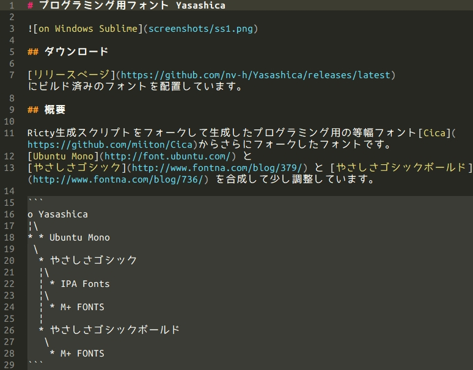

# プログラミング用フォント Utatane



（Color scheme は [gruvbox-material](https://github.com/sainnhe/gruvbox-material) を使用）

## ダウンロード

[リリースページ](https://github.com/nv-h/Utatane/releases/latest)にビルド済みのフォントを配置しています。

## 概要

Ricty生成スクリプトをフォークして生成したプログラミング用の等幅フォント[Cica](https://github.com/miiton/Cica)からさらにフォークしたフォントです。
[Ubuntu Mono](https://font.ubuntu.com/) と
[やさしさゴシックボールドV2](https://booth.pm/ja/items/1833993) を合成して少し調整しています。

```
o Utatane
|\
* * Ubuntu Mono
 \
  * やさしさゴシックボールドV2
   \
    * M+ FONTS
```

## ビルド

### 依存関係
- FontForge（このリポジトリにサブモジュールとして含まれています。Windowsは公式ビルドを使用）
- [uv](https://docs.astral.sh/uv/)（fontTools などの Python 依存を `pyproject.toml` で管理）
- ビルドツール：cmake, ninja-build, build-essential
- 開発ライブラリ：libjpeg-dev, libtiff5-dev, libpng-dev, libfreetype-dev, libgif-dev, libgtk-3-dev, libxml2-dev, libpango1.0-dev, libcairo2-dev, libspiro-dev, libwoff-dev, python3-dev, gettext

### ビルド手順

```bash
git clone git@github.com:nv-h/Utatane.git
cd Utatane

# サブモジュールの初期化・取得
git submodule update --init --recursive

# 必要な依存関係のインストール（Ubuntu/Debian系の場合）
sudo apt-get install libjpeg-dev libtiff5-dev libpng-dev libfreetype-dev libgif-dev libgtk-3-dev libxml2-dev libpango1.0-dev libcairo2-dev libspiro-dev libwoff-dev python3-dev ninja-build cmake build-essential gettext

# Python依存（fontTools など）のインストール
uv sync

# FontForgeのビルド
cd fontforge
mkdir -p build
cd build
cmake -GNinja ..
ninja

# フォント生成（uv run 経由で ttx を PATH に入れる）
cd ../..
uv run ./fontforge/build/bin/fontforge -lang=py -script ./utatane.py
```

**Windows環境の場合:**

[FontForge のリリース](https://github.com/fontforge/fontforge/releases)から Windows 版（64bit）をインストールして使います。

```ps1
uv sync
# 既定のインストール先を使用する場合
uv run 'C:\Program Files\FontForgeBuilds\bin\fontforge.exe' -lang=py -script .\utatane.py
```

### オプション
- `--no-fit-win-metrics`：Windows（GDI）で欠けないようにする縮小をせず、元の字形のまま生成します。
  既定では、行の上下（usWinAscent / usWinDescent）からはみ出すベトナム語の大文字などを縮めて収めています。
- `--ttf-hinting`：TrueType のヒンティング命令を自動生成して付けます（既定は付けません。従来の配布フォントも命令なしです）。

### 生成確認
生成が成功すると、`dist/`ディレクトリに以下のファイルが作成されます：
- `Utatane-Regular.ttf` （約3MB）
- `Utatane-Bold.ttf` （約3MB）

## Rictyからの変更点

* 英数字に Ubutnu Mono を使用しています
* それ以外の文字に やさしさゴシックボールドV2 を使用しています
* 非HiDPI（非Retina）のWindowsでも文字が欠けません


## バリエーション

| ファイル名                  | 説明     |
| ----                        | ----     |
| Utatane-Regular.ttf         | 通常     |
| Utatane-Bold.ttf            | 太字     |

斜体はおかしくなるので未対応。

## ディレクトリ構成

```
Utatane/
├── utatane.py              # メインのフォント生成スクリプト
├── glyph-compare.sh        # グリフ形状比較統合ツール
├── sourceFonts/            # ソースフォントファイル
├── fontforge/              # FontForgeサブモジュール（リリース 20251009）
├── dist/                   # 生成されたフォントの出力先
├── tmp/                    # 一時ファイル・PDF出力先
├── test/                   # テスト関連ファイル
│   ├── font_disp.txt       # フォント表示テスト用文字セット
│   ├── glyph_data_extractor.py   # グリフデータ抽出（FontForge用）
│   ├── glyph_visualizer.py       # グリフ可視化（matplotlib用）
│   └── ... (その他のテストスクリプト)
├── analysis/               # 文字幅分析スクリプト
│   ├── README.md
│   ├── font_analysis.py
│   └── ... (その他の分析スクリプトなど)
├── docs/                   # 開発ドキュメント
│   ├── README.md
│   ├── character_width_comprehensive_analysis.md    # 文字幅問題包括的分析
│   ├── font_processing_investigation_report.md     # フォント処理ライブラリ調査
│   └── ... (その他のドキュメント)
├── CLAUDE.md               # Claude Code向け開発ガイダンス
└── README.md               # このファイル
```

## 開発者向け情報

### 文字幅問題について
M+ 1mとの文字幅比較、現行版の修正候補、幅ルールの提案は[文字幅監査と設計方針案](docs/character_width_audit.md)を参照してください。

### 分析ツール
文字幅の詳細分析を行うスクリプトは `analysis/` ディレクトリに格納されています。使用方法は `analysis/README.md` を参照してください。

### リントと整形
Python の依存は `pyproject.toml` と `uv.lock` で管理しています。リンター・フォーマッターの ruff も開発用依存に含まれています。

```bash
uv sync
uv run ruff check
uv run ruff format
```

## ライセンス

フォント本体は、[Ubuntu Font License](https://ubuntu.com/legal/font-licence)で、生成スクリプトなどはMITライセンスとしています。


## 謝辞

Utataneフォントの合成にあたり[フォーク元のCicaフォント作成者](https://github.com/miiton)に感謝します。
また、以下の素晴らしいフォントを作成してくださった方々もありがとうございます。ありがたく使わせていただきます。

- [Ubuntu Font Family](https://font.ubuntu.com/)
- [やさしさゴシックボールドV2](https://booth.pm/ja/items/1833993)
- [M+ FONTS](https://mplusfonts.github.io/)
